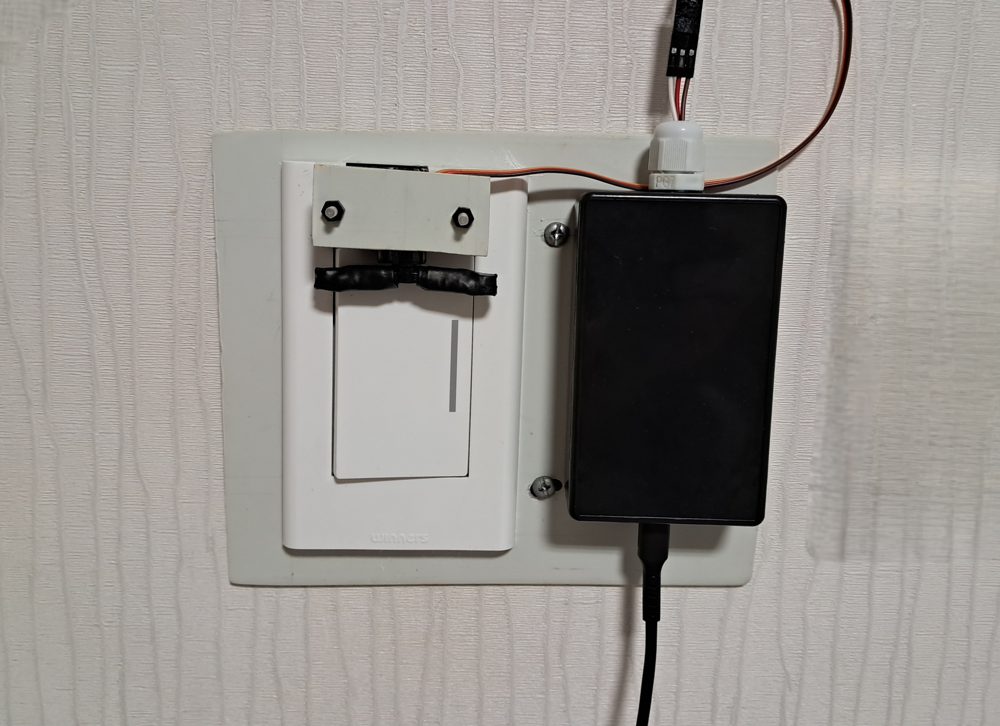
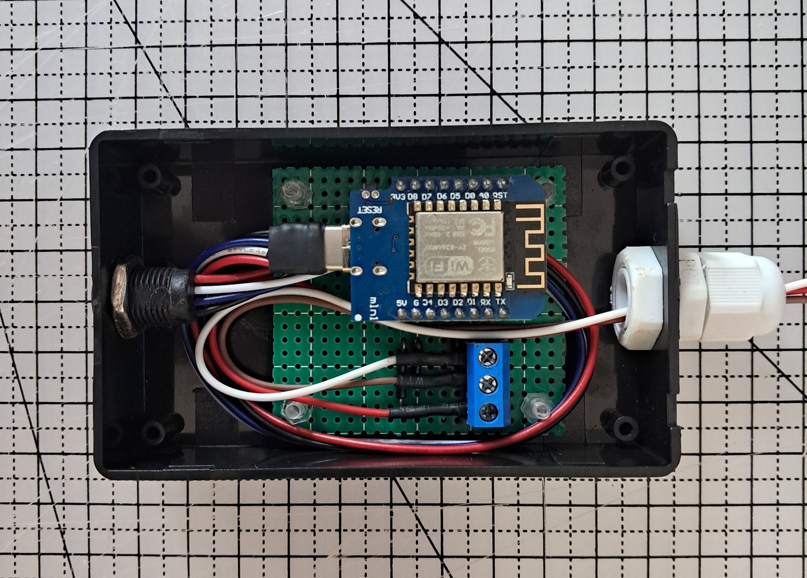
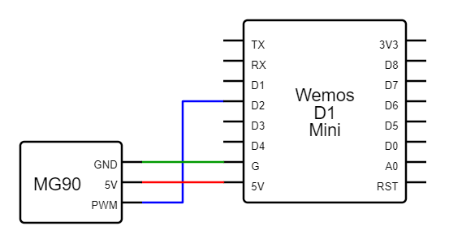

## 프로젝트 개요

<table>
  <tr>
    <td>
      
    </td>
    <td>
      
    </td>
  </tr>
</table>

Wemos D1 Mini 보드에서 웹서버를 실행하고, 클라이언트의 요청에 따라 MG90 서보모터로 전등 스위치를 조작한다.

## 개발 배경

**2024년 8월.** NTP 와이파이 전자시계를 완성한 이후 자신감이 생겨서 다른 주제를 찾다가 전등을 제어해보고 싶다는 생각이 들었다. 나는 암막커튼을 사용한다. 암막커튼은 잘때는 좋지만 일어날때는 힘들다. 만약 알람과 동시에 전등이 켜진다면 아침에 일어나기가 훨씬 수월해질 것 같았다.

전등을 제어하는 방법은 세 가지를 생각해볼 수 있다. 일체형으로 스위치 자체를 만드는 것, 릴레이를 만드는 것, 그리고 똑딱이 스위치를 눌러주는 스위치봇을 만드는 것이다.

스위치봇을 선택한 가장 큰 이유는 전원공급의 문제였다. 일체형 스위치나 릴레이는 공간의 제약 때문에 작은 전원 모듈이 필요하다. 그리고 220V를 공급받는 만큼 무엇보다도 안전이 중요하다. 하지만 만족할만한 220V → 5V 컨버터 모듈을 찾을 수가 없었다. 그래서 콘센트에서 USB 충전기로 전원을 공급받기로 했다. 외부에서 전원을 연결한다면 벽에 매립된 스위치나 릴레이보다는 외부에 노출된 스위치봇이 좋다고 생각했다.

## 결선도

## 동작 설명

https://github.com/user-attachments/assets/cc2e17dd-a77b-42cc-a017-99cbb3615d39

1) 서보모터의 기본 위치(midAngle)는 90도이다

2) 브라우저로 컨트롤 페이지에 접속하면 스위치봇이 페이지를 응답한다

3) 브라우저에서 switch-on 요청이 들어오면

3-1) 서보모터를 onAngle(54도)로 회전시켰다가, 다시 midAngle로 회전시킨다

3-2) 스위치 상태를 on으로 변경하고 브라우저에게 스위치 상태를 응답한다

4) 브라우저에서 switch-off 요청이 들어오면

4-1) 서보모터를 offAngle(114도)로 회전시켰다가, 다시 midAngle로 회전시킨다

4-2) 스위치 상태를 off로 변경하고 브라우저에게 스위치 상태를 응답한다

### 네트워크 관련

이 스위치봇은 서버를 실행하기 때문에 아이피를 고정하지 않으면 내부망의 다른 기기가 제대로 접속할 수 없다. 그래서 보드의 MAC 주소를 알아내서 공유기에서 고정IP를 할당했다.

그리고 갤럭시 스마트폰에서 알람이 울리면 '웹사이트로 이동' 기능으로 스위치봇에 GET 요청을 보내는 루틴을 만들어서 조명 알람으로 사용하고 있다.

### 전기작업 관련
내 방에는 원래 대기전력 차단 기능이 포함된 터치식 전등 스위치가 붙어있었다. 그래서 스위치봇을 설치하려면 우선 스위치부터 똑딱이로 바꿔야 했다. 해당 내용은 [이 페이지에서 볼 수 있다.](./docs/ElectricWork.md)