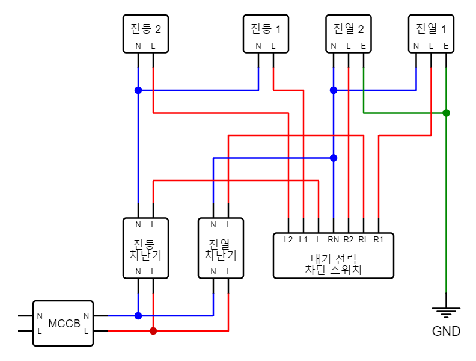
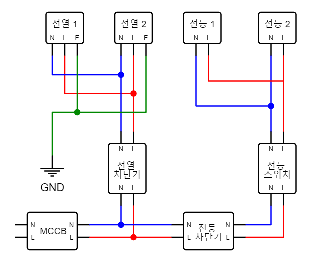
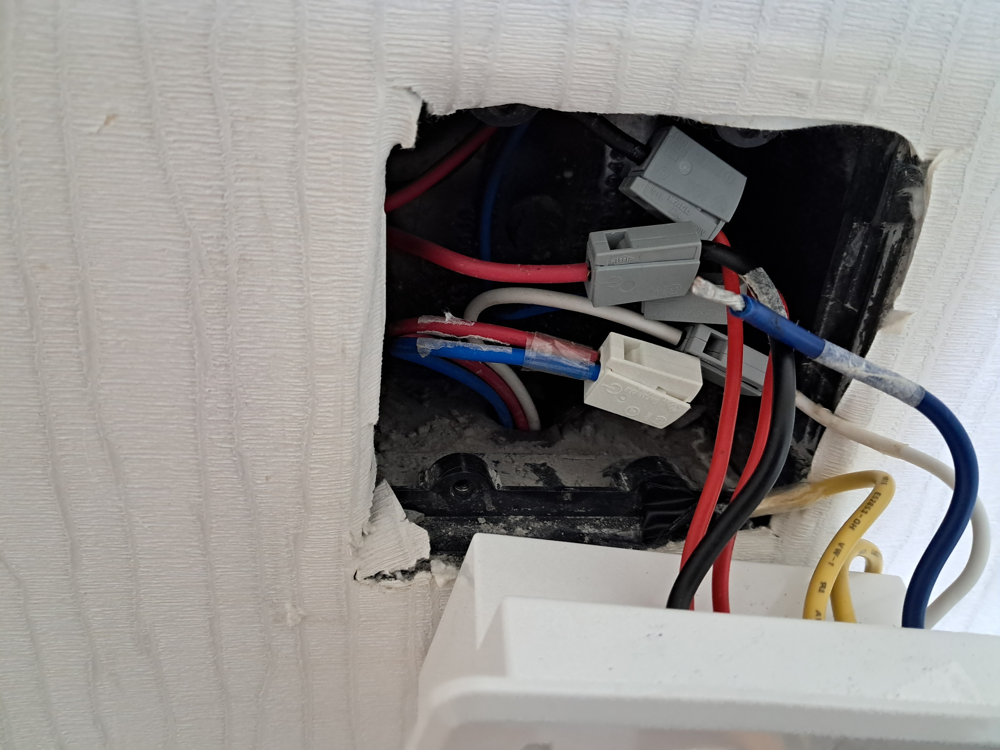
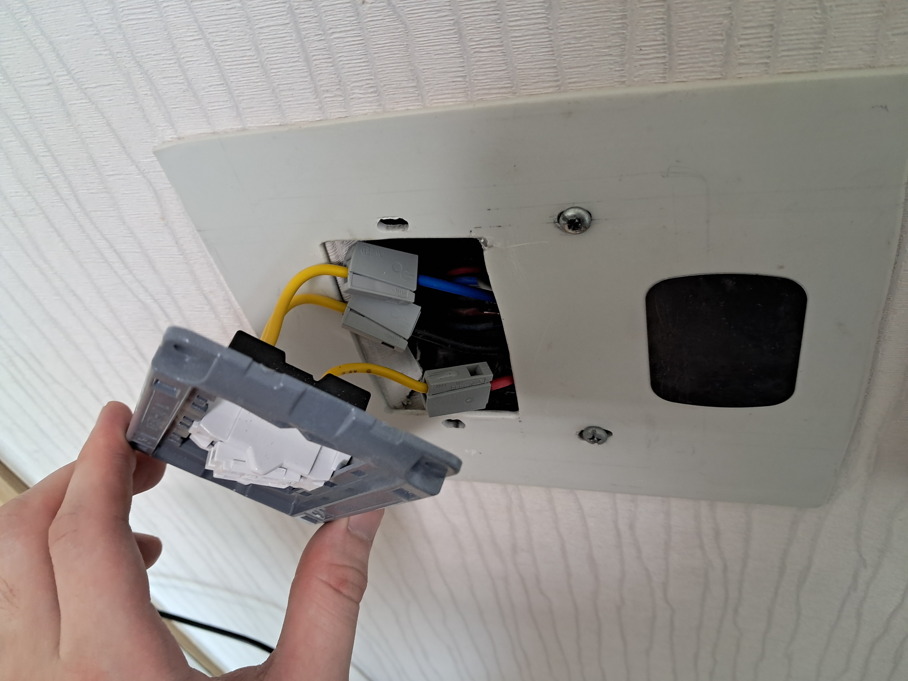

## 회로도 및 계획

### 기존 대기전력 스위치 회로도

대기전력 스위치 제조사 웹사이트에서 결선도를 찾았는데 화질이 엄청나게 안 좋아서 한번 새로 그려봤다.

### 똑딱이 스위치 계획 회로도

그걸 똑딱이 스위치로 바꾸면 이렇게 되어야 하겠으나... 아파트라는 것이 딱히 성의있게 짓는 게 아니다보니 실제 배선을 살펴보고 다시 파악하는 것이 중요하다.

## 실제 시공

### 대기전력 스위치 탈거

위에서 내려오는 세 가닥 중 검정 선이 전등 스위치 입력선이다. 그리고 빨간 선과 파란 선은 스위치에서 전등으로 가는 출력선이다. 

아래에서 올라오는 세 가닥 중 흰 선은 대기전력 스위치에서 사용하던 중성선이다. 빨간 선은 전열 차단기에서 스위치 박스로 들어오는 선이고, 파란 선은 스위치 박스에서 문쪽 콘센트로 나가는 선이다.

### 똑딱이 스위치 설치

혹시라도 4구 스위치 박스에 맞는 1구 스위치가 있는지 찾아봤지만 역시 찾을 수가 없었다. 애초에 대기전력 차단 스위치 때문에 거실도 아닌 방에다가 4구 박스를 매립해놓다니 말도 안 되는 일이다. 

결국 PVC 판을 타공해서 직접 브라켓을 만들었다. 오른쪽에 붙어있는 철판은 스위치봇의 컨트롤박스를 자석으로 부착하는 용도이다.